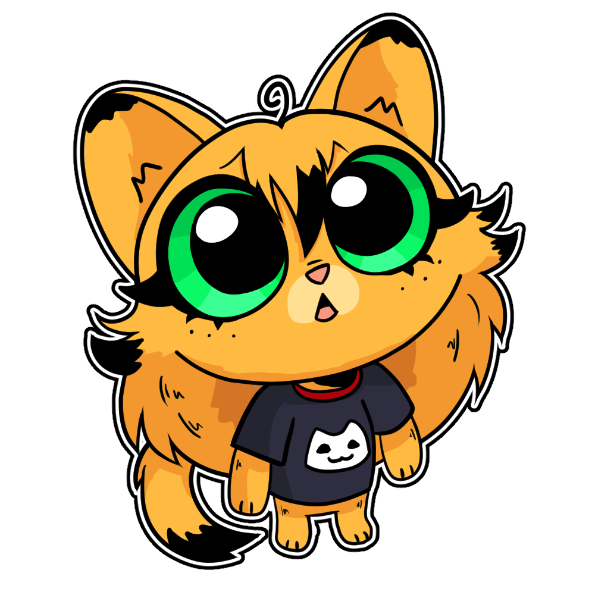

<p align="center">
  
</p>

# marmalade.you

Marmalade (Mal for short) is a CC0 catgirl, so you can use her for basically anything, no need to ask!

This is the source code for [marmalade.you](https://marmalade.you), where I share everything Marmalade: stickers, CSP files, PNGtuber models, LoRAs, and whatever other people make with her.

- **[The Source](https://marmalade.you/lab/)** - where I drop my files (every version of them)
- **[In The Wild](https://marmalade.you/community/)** - what other people made with her
- **[Mal's Family Tree](https://marmalade.you/family/)** - which piece grew out of which, plus the people and things that inspired her
- **[Who Is She?](https://marmalade.you/about/)** - her story

## Run locally

You need [Hugo](https://gohugo.io/) (extended edition, 0.158 or newer).

```bash
hugo server -D
```

Then open http://localhost:1313

## How the site works

- `content/lab/` - each folder is one thing you can download (sticker, model, LoRA, etc.), with its story in `index.md`
- `content/family/` - the text on the family tree page (the tree itself comes from the lab pages, see below)
- `data/remixes.yaml` - everything on In The Wild
- `static/stickers/` - sticker images used for thumbnails and the decorate feature (yes, you can literally stick stickers all over the site!)
- `assets/css/` - styles (Hugo Pipes, fingerprinted)
- `assets/js/` - sticker drawer, identity widget (the little "Hello, Guest" in the top bar), file downloads, form submission, The Source filters, and the family tree's zoom and drag

Downloads are served from Cloudflare R2 via a Worker API. The site fetches version listings at runtime.

### The family tree

Each lab page can say which Mal piece it grew out of, and what outside stuff inspired it (basically the programmers equivalent for art):

```yaml
based_on: ["marmalade-origin"]   # the Mal piece(s) this one grew out of
inspired_by:                     # someone else's thing that inspired it (text and a link only, it's theirs)
  - name: "Helline"
    by: "docmorb"
    url: "https://www.deviantart.com/doctormorbis"
    kind: "character"            # sets the colour of its washi tape
```

All the `inspired_by` fields are explained at the top of `layouts/partials/graft-info.html`. Pieces in `data/remixes.yaml` can use `based_on` too, so fan art shows up on the tree as well.

## Submit your work

If you made anything with her (and I genuinely mean *anything*), please send it over!
Two ways:

1. **The easy way** - use the [submit form](https://marmalade.you/submit/) on the site
2. **Fork & PR** - add your piece to `data/remixes.yaml` and open a pull request ([how to do that](CONTRIBUTING.md))

Either way, you keep all the rights to your piece, unless you choose to release it as CC0 like Mal.

## License

There are a few different things in here, so:

- **Marmalade, and the art I made of her**, is **CC0 (public domain)**. Use her however you want. Every piece on The Source says its licence on its page.
- **The website code** is released under the [Unlicense](UNLICENSE), so it's public domain too.
- **The pieces on In The Wild belong to the people who made them**, unless their entry says CC0. That includes the images in `static/images/remixes/`: they're here with the artists' permission, but they're **not** CC0, so please ask them before using them anywhere else.
- **The inspirations** on the family tree (other people's characters, art and shows) are only text and links, and they belong to whoever made them.

One exception: the Marmalade LoRA follows the Krea 2 Community License, because it's trained on top of Krea 2.


Now go have fun with Mal!